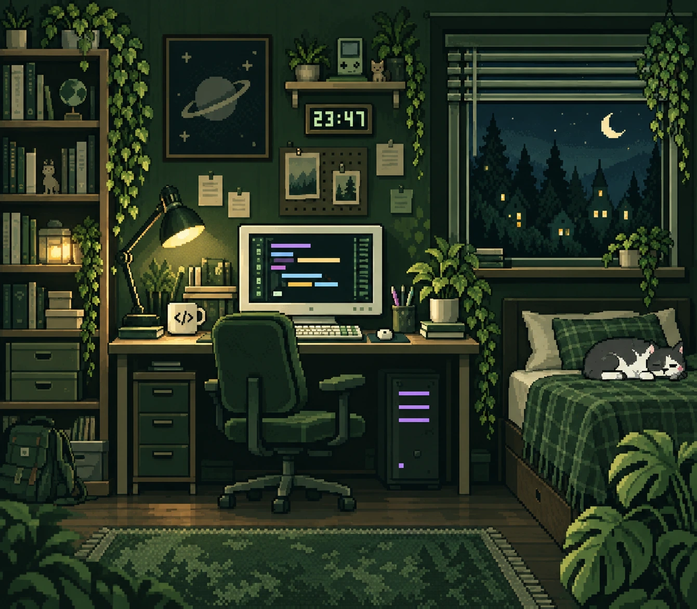

<p align="center">
  
</p>

<h1 align="center">Vojta · můj kousek internetu</h1>

<p align="center">Osobní a školní portfolio v pixelovém stylu. Trocha kódu, hodně pokusů.</p>

<p align="center">
  <a href="https://itzlebyy.github.io/">Otevřít web</a> ·
  <a href="https://itzlebyy.github.io/projects/arcade/">Pixelová herna</a> ·
  <a href="https://itzlebyy.github.io/citace.html">Citace AI</a>
</p>

<p align="center">
  
</p>

## Co tu najdeš

- **Portfolio:** představení, projekty, co se učím a kontakty, které zkopíruješ kliknutím.
- **Pixelový svět:** vlastní grafika, lesní a noční paleta, měsíc a padající hvězdy.
- **Plynulá navigace:** posouvání mezi sekcemi a ukazatel průběhu čtení.
- **GoonOnTheGo Search:** projekt inspirovaný vyhledávačem Google, včetně obrázků a rozšířeného hledání.
- **Malá herna:** blackjack s rozdáváním karet, Snake a test postřehu.
- **Skrytá překvapení:** pár věcí objevíš až při hraní a zkoušení.

Web je responzivní a používá **HTML, CSS a JavaScript** bez frameworků a bez sestavování. Písmo i grafické podklady jsou uložené přímo v repozitáři.

## Spuštění lokálně

Stáhni nebo naklonuj repozitář a otevři `index.html` v prohlížeči. Pro běžnou práci můžeš použít také lokální server, například s Pythonem 3:

```sh
python -m http.server 8000
```

Příkaz spusť v kořenové složce projektu a otevři [localhost:8000](http://localhost:8000). Není potřeba instalovat balíčky ani nastavovat API klíče.

## Struktura projektu

```text
.
├── index.html                 # hlavní portfolio
├── style.css                  # rozvržení hlavní stránky
├── citace.html                # čitelná citace AI na webu
├── CITACE-AI.md                # citace ve formátu Markdown
├── assets/                    # sdílené styly, grafika, písmo a interakce
│   ├── pixel-theme.css        # palety, pixelový vzhled a pozadí
│   ├── eastereggs.js          # přepínač barev a skrytá překvapení
│   └── document.css           # vzhled dokumentace na webu
└── projects/
    ├── arcade/                # blackjack, Snake a postřeh
    └── googlesearch/          # GoonOnTheGo Search
```

## Ukládání výsledků

Rekordy her, nalezená překvapení a vybraná barevná paleta se ukládají pomocí `localStorage` jen do aktuálního prohlížeče. Projekt nemá backend, účty ani databázi výsledků. Pokud je ukládání zablokované, hry fungují dál bez trvalého uložení.

## Vznik a podklady

Současnou podobu portfolia vytvořil **OpenAI Codex** podle zadání a průběžné zpětné vazby autora. Ilustrace pokoje vznikla pomocí nástroje OpenAI pro generování obrázků. Rozsah práce AI a role autora jsou popsané v [citaci použití AI](CITACE-AI.md), která má i [čtenářskou verzi na webu](https://itzlebyy.github.io/citace.html).

Pixelové nadpisy používají **Pixelify Sans** od Stefie Justprince pod licencí SIL Open Font License 1.1. Podrobnosti najdeš v [dokumentaci podkladů](assets/README.md) a [licenčním textu písma](assets/fonts/OFL-PixelifySans.txt).
